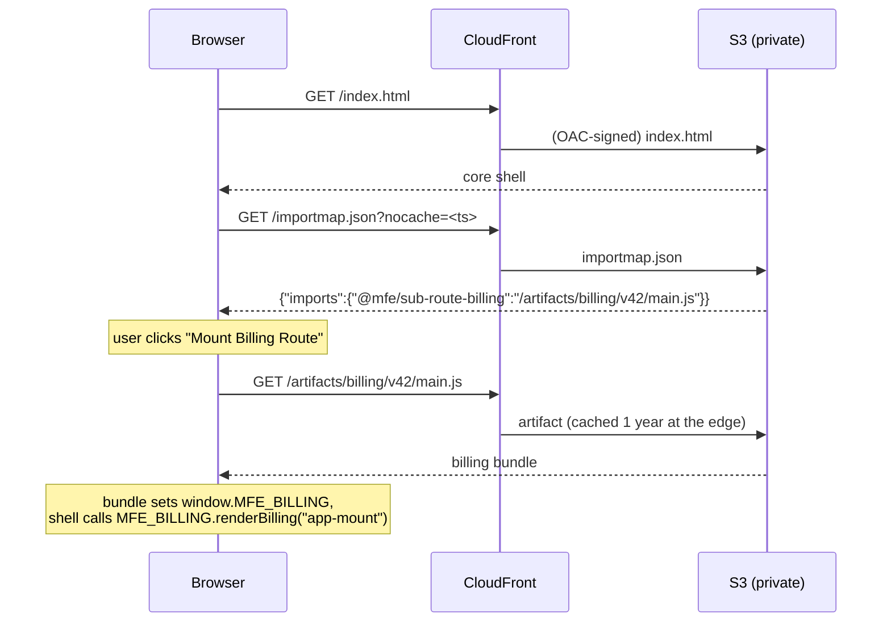

# Architecture

How the service works end to end: what gets built, where it lives, what the
browser does at runtime, and what is deliberately (or accidentally) missing.

Related: [CI/CD](ci-cd.md) · [Releasing, tagging and rollback](releasing.md)

## What it is

A micro-frontend demo. A small **core shell** page loads a **billing**
sub-route at runtime. The shell never hard-codes which billing build to load;
it asks a **manifest** (`importmap.json`) on the CDN. Releasing billing means
uploading a new immutable file and changing one line in that manifest.
Rolling back means changing the line back. Neither requires rebuilding or
redeploying the shell.

| Component | Path | Built to | Deployed as |
|---|---|---|---|
| Core shell | `apps/core-shell` | `dist/index.html` | `s3://<bucket>/index.html` (overwritten each release) |
| Billing sub-route | `apps/sub-route-billing` | `dist/main.js` | `s3://<bucket>/artifacts/billing/v<N>/main.js` (immutable, one per release) |
| Manifest | n/a, generated | n/a | `s3://<bucket>/importmap.json` (the only mutable pointer) |
| Shared contracts | `libs/shared-contracts` | not built | **not deployed** (see [Known gaps](#known-gaps)) |

There is no application server. Everything served is static files.

## Runtime flow



Details worth knowing:

- The shell does **not** use the browser's native import-map resolution. It
  `fetch`es `importmap.json` itself, looks up `@mfe/sub-route-billing`, injects
  a `<script type="module" src=...>` tag, and then calls
  `window.MFE_BILLING.renderBilling(...)`. The empty `<script type="importmap">`
  in the shell's `<head>` is a placeholder and does nothing.
- If the manifest has no entry for billing, the shell shows
  "Billing mapping path not found in importmap.json". That is exactly what
  `make test-rollback` produces and is the intended "off switch".
- The `?nocache=` query on the manifest fetch defeats browser caching of the
  one file that must always be fresh.

## Hosting (`terraform/main.tf`)

- **S3 bucket** `homelab-mfe-delivery-bucket`: private, all public access
  blocked. S3 bucket names are global, so this name must be free in the account
  you apply it to.
- **CloudFront** distribution in front, default `*.cloudfront.net` domain and
  certificate (no custom domain yet).
- **Origin Access Control + bucket policy**: CloudFront (this one distribution
  only) is the sole reader of the bucket.
- Caching:

| Path | CloudFront TTL | Header written by `publish.sh` | Why |
|---|---|---|---|
| `/artifacts/*` | 1 year (min=default=max) | `public, max-age=31536000, immutable` | Versioned paths never change |
| everything else (`index.html`, `importmap.json`) | 0 | `no-cache` | Must reflect a release immediately |

Because the manifest and shell are never cached, **no CloudFront invalidation
is needed** to release or roll back.

- Outputs: `cdn_domain` (where to browse) and `bucket` (the value of
  `S3_BUCKET`).
- **Not applied yet.** Nothing in this repo has created the AWS resources.
  `terraform validate` passes; that is all that has been checked.

## The release model in one paragraph

Every billing release is a new directory under `artifacts/billing/`, named
after the Jenkins build number. `scripts/publish.sh` refuses to overwrite an
existing one. The manifest is then rewritten to point at it. Because old
directories are never touched, any previous release is a valid rollback target
for as long as it stays in the bucket. The shell is simpler and less safe: it
is a single overwritten file, with no S3 version history (bucket versioning is
not enabled), so rolling the shell back means redeploying an older commit. See
[releasing.md](releasing.md).

## Repository layout

```
Jenkinsfile            CI: build both apps on every branch and PR
Jenkinsfile.cd         CD: publish + tag, main branch only
Makefile               local development against LocalStack
scripts/publish.sh     the ONLY code that uploads to S3 (CD and make both use it)
scripts/update-importmap.js   edits the manifest JSON
apps/core-shell/       shell page and its build.js
apps/sub-route-billing/ billing bundle and its build.js
libs/shared-contracts/ shared config (not currently consumed, see below)
terraform/             S3 + CloudFront
docs/                  you are here
```

Each app's "build" is a tiny `node build.js` that copies (shell) or lightly
rewrites (billing) a file. There are no runtime dependencies and no lockfile
entries; `npm install` is a no-op. The CI/CD pipelines run `npm run build`
per app.

## Known gaps

Documented rather than hidden; none block the demo.

1. **`libs/shared-contracts` is not actually shared.** Billing's `build.js`
   replaces the `import { SHARED_CONFIG } from '@mfe/shared-contracts'` line
   with a hard-coded literal (`apiEndpoint: 'https://homelab.local'`). Editing
   the library changes nothing in the shipped bundle, and no pipeline watches
   it. If it becomes a real dependency, CI/CD change detection must include
   `libs/` (and it will then need its own tag, see [releasing.md](releasing.md)).
2. **`apiEndpoint` is a placeholder** (`https://homelab.local`); billing talks
   to no backend. The "Process Test Payment" button does nothing.
3. **No auth.** The CDN is public to anyone with the CloudFront URL.
4. **Terraform state is local.** There is no remote backend, and `*.tfstate`
   is git-ignored, so state lives on whichever machine runs `apply`. Add an S3
   backend before anyone else applies this.
5. **No shell rollback history.** See above.
6. **Default CloudFront domain and certificate**; no custom domain or WAF.
