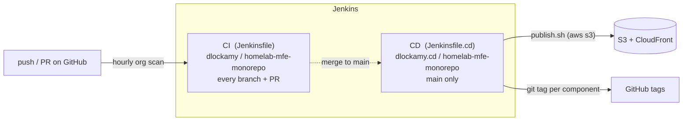

# CI and CD

How code gets from a commit to a running site. Jenkins (`jenkins.softsurve.com`)
is authoritative; there are no GitHub Actions for this repo.

Related: [Architecture](architecture.md) · [Releasing, tagging and rollback](releasing.md)

## At a glance



| | CI | CD |
|---|---|---|
| File | `Jenkinsfile` | `Jenkinsfile.cd` |
| Jenkins folder | `dlockamy` | `dlockamy.cd` |
| Runs on | every branch and every PR | `main` only (other branches do nothing) |
| Does | builds both apps, checks the output | builds what changed, publishes, tags |
| Needs AWS | no | yes (**not yet provisioned**) |
| Status | **working**: PR-1 build #1 SUCCESS on real Jenkins | **built and linted, never run**; deploys are switched off |

## How Jenkins finds this repo

Nothing is configured per repo. Sol's Jenkins (JCasC, `softsurve/sol`) has one
GitHub **organization folder** per org *per Jenkinsfile name*. For the
`dlockamy` account that is `dlockamy` (looks for `Jenkinsfile`) and
`dlockamy.cd` (looks for `Jenkinsfile.cd`), plus other variants (`.pr`,
`.test`, `.infra`, `.release`, `.qa`) that this repo doesn't use.

- Each folder rescans GitHub **hourly**. A new repo, branch or PR appears after
  the next scan. To force it: Jenkins UI → `dlockamy` → **Scan Organization
  Folder Now** (same for `dlockamy.cd`).
- The filename matters. A pipeline called `Jenkinsfile-CD` (this repo's
  original name) is invisible to every folder. It must be exactly
  `Jenkinsfile.cd`.
- Branches and PRs both get their own job. PRs are built as merged with their
  target branch.
- **No webhook is registered**, so pushes are not picked up instantly. Org-level
  hooks aren't available; they must be added per repo (Sol's
  `services/cloudflared-hooks/SERVICES.md` has the procedure and the
  `hooks.dlockamy.com` endpoint).

## Conventions both pipelines follow

These exist because each one broke a real build elsewhere in the studio.

- **`agent { label 'linux-build' }`, never `agent any`.** `any` can schedule on
  the controller, which has no docker CLI. First CI run landed on `callisto`.
- **Build in `node:22-alpine`** via the Docker Pipeline plugin, with
  `args '-e HOME=/tmp -e npm_config_cache=/tmp/.npm'`. The plugin runs the
  container as an arbitrary UID (5005) that has no home directory and no
  `/etc/passwd` entry; `HOME=/tmp` gives npm somewhere to write.
- **Nothing writes into the workspace as root.** A root-owned file in a reused
  workspace breaks the next non-root build's cleanup. The one root container
  (the S3 publish step) only reads the workspace and writes to `/tmp`.
- **Secrets only via `withCredentials`**, in single-quoted shell blocks so
  Groovy never interpolates them into the log.

## CI (`Jenkinsfile`)

Runs on every branch and PR. About 15 seconds.

| Stage | What it does |
|---|---|
| Build | In `node:22-alpine`: `npm run build` for `core-shell` and `sub-route-billing`, in parallel so one failure doesn't hide the other |
| Check output | Fails if either `dist/` file is missing or empty, or if the billing bundle still contains `@mfe/shared-contracts` (browsers can't resolve that alias, so a failed inlining would ship a broken bundle that builds "successfully") |

CI builds both apps every time rather than diffing for changes. They take
seconds, and the original `git diff HEAD~1` approach crashed on a first commit
and missed all but the last commit of a multi-commit push.

Also set: 10-minute timeout, keep 30 builds, and a newer push to the same
branch **aborts** the older running build.

## CD (`Jenkinsfile.cd`)

Runs on `main` only; everything is guarded by `when { branch 'main' }`. At most
one build runs at a time, because two releases would interleave their
read-modify-write of `importmap.json`.

| # | Stage | What it does |
|---|---|---|
| 1 | Detect Changes | `git diff` between this commit and `GIT_PREVIOUS_SUCCESSFUL_COMMIT`. Sets `CORE_SHELL_CHANGED` / `BILLING_CHANGED`. If that commit is unknown (first build) or unreachable (force-push), **both are treated as changed**. |
| 2 | Build | Builds only the changed apps, as the Jenkins UID in `node:22-alpine`. Skipped if nothing relevant changed. |
| 3a | Deploy disabled | When `DEPLOY_ENABLED` is `'false'` (**the shipped default**): marks the build **UNSTABLE** with "Built, NOT deployed". |
| 3b | Deploy to S3 | When `'true'`: in `node:22-alpine` as root, `apk add aws-cli`, then `scripts/publish.sh shell` and/or `publish.sh billing v<BUILD_NUMBER>` for what changed. Uses credential `aws-homelab-mfe-deploy`. |
| 4 | Tag release | After a successful deploy, pushes one git tag per deployed component. See [releasing.md](releasing.md). Uses credential `github-token`. |

Changes to anything other than `apps/core-shell/` or `apps/sub-route-billing/`
(docs, Jenkinsfiles, Terraform, scripts) deploy nothing. Note that a change to
`scripts/publish.sh` therefore does not trigger a release by itself.

### Why deploys ship disabled

The AWS side doesn't exist yet. With `DEPLOY_ENABLED = 'false'` a merge to
`main` builds, goes yellow with a clear message, and never fails for want of a
bucket. Yellow means "built, not deployed", not "broken".

### Turning deploys on

1. **Create the infrastructure.** `terraform -chdir=terraform init && terraform -chdir=terraform apply`.
   Read the plan first. It creates the bucket, CloudFront distribution, OAC and
   bucket policy. Note `cdn_domain` from the outputs. (State is local; see
   [architecture.md](architecture.md#known-gaps).)
2. **Create a narrowly scoped IAM user** for Jenkins, following the studio
   pattern of one purpose-specific key (compare `aws-sol-backup`):

   ```json
   {
     "Version": "2012-10-17",
     "Statement": [
       { "Effect": "Allow",
         "Action": ["s3:GetObject", "s3:PutObject"],
         "Resource": "arn:aws:s3:::homelab-mfe-delivery-bucket/*" },
       { "Effect": "Allow",
         "Action": "s3:ListBucket",
         "Resource": "arn:aws:s3:::homelab-mfe-delivery-bucket" }
     ]
   }
   ```

   `s3:ListBucket` is **required, not optional**: without it S3 answers
   "AccessDenied" instead of "NoSuchKey" for a missing object, and the very
   first release (no manifest yet) is refused as an unreadable manifest.
3. **Add the key to Jenkins** as a `usernamePassword` credential with id
   **`aws-homelab-mfe-deploy`** (username = access key id, password = secret).
   Sol manages credentials through JCasC/Secrets Manager (`softsurve/sol`
   docs); follow that rather than hand-creating it in the UI.
4. **Open a PR flipping `DEPLOY_ENABLED` to `'true'`** in `Jenkinsfile.cd`,
   merge, and watch the first `main` build.
5. **Verify**: open `https://<cdn_domain>/`, click *Mount Billing Route*, and
   check `https://<cdn_domain>/importmap.json` points at `v<that build number>`.

### Credentials used

| Jenkins credential id | Used by | Status |
|---|---|---|
| `github-token` | tag push (CD); org-folder scanning | exists (studio-wide PAT) |
| `aws-homelab-mfe-deploy` | S3 publish (CD) | **does not exist**, create per above |

## Running the same thing locally

`Jenkinsfile.cd` and the Makefile both call `scripts/publish.sh`, so a local
run rehearses the real release against LocalStack (a fake AWS in docker):

```sh
make run-local        # build, release, serve on http://localhost:8080
make build-billing    # cut another billing version
make stop-localstack  # remove the container when done
```

It cannot reach real AWS: credentials are throwaway and every call is pinned to
`localhost:4566`.

## Troubleshooting

| Symptom | Likely cause / fix |
|---|---|
| Repo not in Jenkins | Not scanned yet. Run *Scan Organization Folder Now* on `dlockamy` (and `dlockamy.cd`). Confirm the file is named exactly `Jenkinsfile` / `Jenkinsfile.cd`. |
| `npm: not found` | Build ran outside the node container, typically an old `agent any` Jenkinsfile. `main` #1 failed this way before PR #1 merged. |
| `docker: not found` | Landed on the controller. Check the pipeline has `agent { label 'linux-build' }`. |
| CD build is yellow (UNSTABLE) | Expected while `DEPLOY_ENABLED` is `'false'`. |
| `Cannot find credentials` / credential not found | `aws-homelab-mfe-deploy` hasn't been created. |
| `Could not read the live importmap.json; refusing to overwrite it` | `publish.sh` could not tell "no manifest yet" from "can't read it". Usually bad credentials, wrong bucket, or the IAM user lacks `s3:ListBucket`. Fix the cause. Do **not** work around it: the check exists so a transient error can never replace a live manifest with an empty one. |
| `Refusing to overwrite already-published artifact` | That `v<N>` is already in the bucket (the Jenkins job was probably recreated and build numbers restarted). Choose a new version; never delete the old one if a manifest or rollback may still point at it. |
| Tag push fails | `github-token` lacks write access to the repo, or the tag already exists. The deploy has already succeeded by then; see [releasing.md](releasing.md). |
| `EACCES` writing npm cache | `HOME=/tmp` missing from the docker `args`. |
| Site loads but billing says "mapping path not found" | The manifest is empty or lacks the billing entry. Re-run a billing release, or `publish.sh rollback <version>`. |

## What has and hasn't been proven

Proven on the real Jenkins: discovery by the `dlockamy` folder, the CI pipeline
end to end on a `linux-build` agent in `node:22-alpine` as UID 5005.

Proven locally only: `publish.sh` (release, first release with no manifest,
rollback, refusal paths) against LocalStack; both containers' behaviour; the
tag commands against a scratch git remote. Both Jenkinsfiles pass Jenkins'
Declarative linter.

**Not yet exercised anywhere:** the CD pipeline running on Jenkins, real AWS,
the Terraform apply, and the tag push from Jenkins to GitHub.
