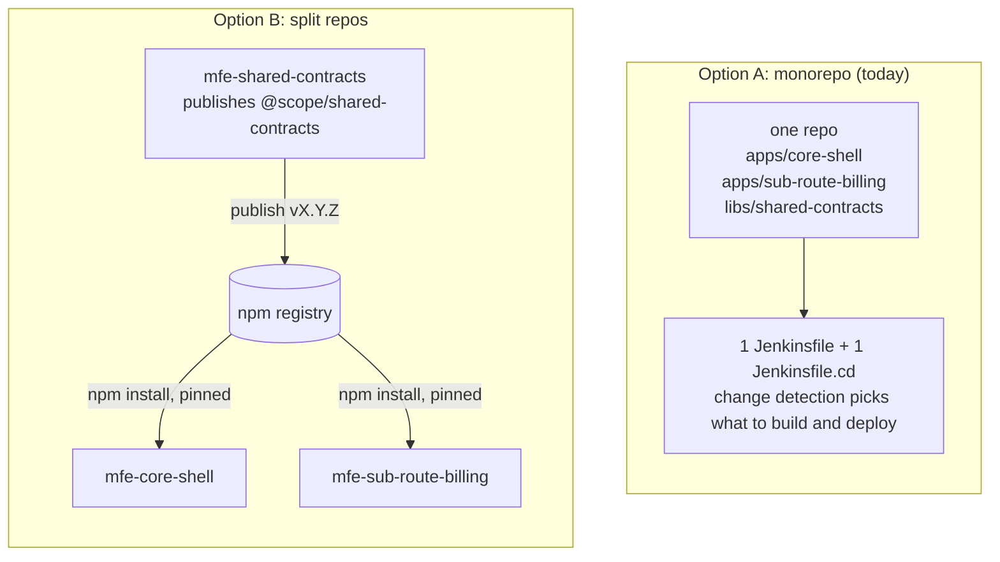

# Monorepo vs split repos with a shared npm package

A decision doc: keep this repo as one monorepo, or split it into one repo per
deployable plus a published shared package. Includes what each choice means for
Jenkins (what we run today) and Harness.io (an alternative CI/CD platform).

Related: [Architecture](architecture.md) · [CI and CD](ci-cd.md) · [Releasing, tagging and rollback](releasing.md)

## Recommendation

**Stay a monorepo for now.** Revisit when one of the [split triggers](#when-to-split)
below is true. Reasons specific to this repo:

1. **There is no real shared code to version.** `libs/shared-contracts` is not
   consumed (billing's `build.js` hard-codes the config; see
   [architecture.md](architecture.md#known-gaps)). A shared package solves a
   problem we do not have yet.
2. **Our registry can't host it today.** Sol's Nexus serves Maven, Cargo,
   RubyGems, NuGet, APT, Dart and Docker. **npm is not among them**
   (`softsurve/sol` `AGENT.md` and `services/nexus/SERVICES.md`). Splitting
   means first adding an npm repo to Nexus (a Sol change), or using another
   registry (GitHub Packages, Harness Artifact Registry, npmjs).
3. **The pipeline machinery is already built for one repo.** Per-component tags,
   change detection, a shared publish script and rollback exist and are
   documented. Splitting would rebuild that three times.
4. **Two small apps, one owner.** The costs of a monorepo (CI scaling, access
   control, noisy history) are not being paid yet.

If a shared library does become real, the cheap middle path is: stay a monorepo,
turn on npm workspaces so the apps genuinely import the lib, and publish the lib
as a package **only when something outside this repo needs it**.

## The two options

## What "shared code" means for micro-frontends

One thing is easy to miss and applies to **both** options. The shell loads
billing at runtime, and each deployed bundle carries its **own build-time copy**
of any shared code. So at any moment production can hold a new shell and an
older billing built against an older contract. A monorepo makes the
*source* consistent, but it does not make *deployed* versions consistent, because
the apps release independently (that is the point of the manifest design).

So in either option, shared contracts need the same discipline:

- additive changes only, or an explicit version negotiation;
- a **contract test** that loads the previous released billing bundle against the
  current shell (and vice versa) before release;
- a rule for how long old versions stay supported.

The monorepo's real advantage is that one commit can change the contract and
every consumer **and** the test together. A split repo can only do that as a
sequence of coordinated releases.

## Side-by-side

| Dimension | Monorepo | Split repos + shared npm package |
|---|---|---|
| **Changing shared code and its users** | One PR, one review, tested together | Publish the lib, then a bump PR per consumer. Breaking changes need a migration window. |
| **Version of shared code in use** | Whatever is in the commit | Explicit semver pin per consumer; consumers can lag (a feature and a risk) |
| **Release independence** | Per-component via change detection and per-component tags (built) | Natural: each repo releases itself, plain `v1.2.3` tags |
| **Build/CI complexity** | Needs path filtering ("what changed?") and gets harder as it grows | Each pipeline is simple; there are more of them |
| **CI cost at scale** | Grows with the repo unless selective; mitigated by affected-graph tools | Proportional to the repo; no cross-repo waste |
| **Access control / ownership** | Repo-wide (CODEOWNERS can narrow review, not read access) | Per-repo permissions; clean team boundaries |
| **Blast radius of a bad commit** | One bad merge can break CI for everything | Contained to one repo |
| **Tagging** | Prefixed per component (`apps-core-shell-vN`), already done | Plain semver per repo; simpler to read, fine for tooling |
| **Rollback** | Same mechanism in both: re-point the manifest. Source-level rollback is a normal revert. | Same, but "what shared version was this built with?" lives in the lockfile |
| **Local dev loop** | One clone, one `make run-local`. With workspaces, edits to the lib show up instantly. | Several clones; need `npm link` or a file dependency to test unpublished lib changes |
| **Drift risk** | Low (one version of the lib) | Real: consumers on different lib versions, security fixes applied unevenly |
| **Onboarding** | One thing to clone and understand | Need to know which repo owns what and how they connect |
| **Tooling to maintain** | Path filtering, optionally workspace/affected tooling | A registry, publish pipeline, publish credentials, and a dependency-update bot (Renovate or Dependabot) |
| **History** | One log, can get noisy | Clean per-project log; history from this repo would need splitting out |

## Jenkins considerations

Context: Jenkins at `jenkins.softsurve.com` is authoritative for releases. It
discovers repos via GitHub org folders (`dlockamy` for `Jenkinsfile`,
`dlockamy.cd` for `Jenkinsfile.cd`, and other variants including
`dlockamy.release`). See [ci-cd.md](ci-cd.md).

### If we stay a monorepo

- **One pair of pipelines, no new Jenkins configuration.** Already working for CI.
- **Change detection lives in our Jenkinsfile.** Today `Jenkinsfile.cd` diffs
  against `GIT_PREVIOUS_SUCCESSFUL_COMMIT` and falls back to "everything
  changed". Gaps to know about:
  - `libs/` is not watched (fine today because nothing consumes it; it must be
    added the day something does);
  - the `changeset` condition built into Declarative pipelines is an alternative,
    but as I understand it it only sees the *current build's* changelog, so
    changes from an earlier failed or aborted build can be missed. That is why
    the pipeline diffs against the last **successful** commit instead.
  - Every new component means editing the Jenkinsfile (a variable, a `when`, a
    publish line, a tag line). It scales to a handful of components, not dozens.
- **Tags:** per-component, prefixed (`apps-<name>-v<N>`), already implemented.
- **One webhook** (not registered yet; Sol's org-level webhooks aren't
  available, so hooks are per repo).
- **One build at a time** on `main` (`disableConcurrentBuilds`), which also
  serializes releases. That is a feature for the shared manifest and a slight
  bottleneck if many components release often.

### If we split

- **Discovery is free:** each new repo with a `Jenkinsfile` / `Jenkinsfile.cd` is
  picked up by the existing org folders on the next hourly scan. No JCasC change
  per repo.
- **Per-repo work that is not free:**
  - a webhook per repo (org-level hooks aren't available, so Sol registers them one repo at a time through the API, 33 so far);
  - a copy of the Jenkinsfile conventions per repo (agent label `linux-build`,
    node container, credentials). Without a Jenkins **shared library** these
    drift. Creating one is extra Jenkins work.
  - per-repo credentials/IAM if you want least privilege.
- **The shared package needs a release pipeline** (`Jenkinsfile.release`, picked
  up by `dlockamy.release`): run tests, `npm publish` to the registry on a tag.
  Credentials: Jenkins already has `nexus-credentials`, **but Nexus has no npm
  repository yet**, so step zero is a Sol change to add `npm-hosted`,
  `npm-proxy` and `npm-group`, and to point consumers' `.npmrc` at the group.
- **Consumers need registry access in CI:** `npm ci` inside the build container
  needs an `.npmrc` with a token, injected through `withCredentials`. The
  containers run as an arbitrary UID with `HOME=/tmp`, so the `.npmrc` must be
  written somewhere writable and never into the workspace.
- **No cross-repo "rebuild consumers when the lib changes".** Jenkins has no
  dependency graph. Options: a dependency bot opening bump PRs (best, and each
  PR is built by CI), a scheduled job, or an explicit trigger step at the end of
  the lib's release. Without one of these, consumers silently stay on old versions.
- **Tags are simpler** (`v1.2.3` per repo), and the `apps-<name>-v<N>` scheme
  goes away.
- **Rollback of billing is unchanged**; it only depends on the S3 manifest.
- **The shared manifest becomes a cross-repo concern.** Today one pipeline owns
  `importmap.json` and `disableConcurrentBuilds` serializes writes. With separate
  repos, two billing/shell-style pipelines could race to read-modify-write the
  manifest. `publish.sh` is safe against *partial* failures but not against
  concurrent writers; split repos would need a lock (for example a build lock
  shared across jobs) or conditional writes.

## Harness.io considerations

Harness is **not part of the studio's stack today** (nothing in the vault or
context mentions it), and Jenkins is documented as authoritative for releases.
Adopting it would be a new-vendor decision, not a configuration change. What
follows is what its documentation says it would give us. Facts were checked
against the Harness docs; see [Sources](#sources).

### What Harness changes about each option

| Topic | What Harness provides | Effect on the choice |
|---|---|---|
| **Path-based triggers** | Webhook triggers have a **Changed Files** condition. Documented for push events; for pull requests the docs list an exclusion only for Azure Repos, and say nothing either way for GitHub PRs. Multiple paths use the **Regex** operator, e.g. `apps/core-shell/.*`. | Makes monorepo "what changed?" a **platform feature configured per trigger** instead of Groovy in a Jenkinsfile. Removes our biggest monorepo-on-Jenkins gap. |
| **Stage selection from a trigger** | A trigger can run specific pipeline stages ("selective stage execution"). | One pipeline, with a billing stage and a shell stage, each fired by its own path trigger. |
| **Pipelines as code** | Git Experience stores pipelines, input sets and templates in Git (remote pipelines). | Comparable to a Jenkinsfile. Reviewable, versioned with the code. |
| **Reuse across repos** | Templates (including remote templates in Git). | Helps a **split** setup avoid copy-pasted pipeline logic. Jenkins' equivalent is a shared library. |
| **Private npm registry** | Artifact Registry has an **NPM registry** type, private or public, with an optional **upstream proxy** (npmjs or a custom URL). | Removes the "Nexus has no npm" blocker for a split, without changing Sol. It is another place credentials and packages live. |
| **S3 upload** | CI step "Upload Artifacts to S3": AWS connector, region, bucket, source path, target, and an **endpoint URL** (so LocalStack or MinIO are possible). | Fine for plain uploads. I found **no cache-control setting** in the step's documented fields, so `publish.sh` (immutable headers, manifest safety, rollback) would still be needed, run from a script step. |
| **Static-site deploy type** | CD has native types for Kubernetes, ECS, Lambda, Serverless, Tanzu and Custom deployments. I found **no native S3/CloudFront static site type**. | Deploying here means Custom Deployment or script steps, i.e. the same scripts we already have. |
| **Where it runs** | A **delegate** (a Linux container you run) executes the work in your network. For Harness SaaS it needs only **outbound HTTPS 443** to `app.harness.io` (and optionally `logging.googleapis.com`), plus network access to whatever it deploys to and pulls from. | Can reach Sol/Nexus/LAN services without opening inbound ports. But it is one more service to run, size and patch. Sol's Jenkins is already inside that network. |
| **Cost** | A free self-serve tier exists. | Limits changed in 2026 and I could not verify current numbers on Harness' own pricing page. Check before relying on it. |

### Harness plus a monorepo

Strongest fit of the four combinations for Harness. Path triggers, selective
stages and Git-stored pipelines map directly onto "deploy only what changed".
Still true: `publish.sh`, `update-importmap.js` and the Makefile stay. They are
platform-independent, which is the reason they were pulled out of the Jenkinsfile.

### Harness plus split repos

Template reuse and the built-in npm registry (with proxy) are real
advantages, and path filtering stops mattering. Cross-repo orchestration (lib
released → rebuild consumers) is still something to design; this doc did not
verify a built-in dependency graph, so assume a dependency bot or an explicit
trigger.

### Costs of moving to Harness at all

- A second CI/CD system alongside Jenkins, or a migration of the studio's
  existing pipelines. Everything else in the studio (credentials in AWS Secrets
  Manager and JCasC, Slack alerts, agent fleet, backups) is wired to Jenkins.
- Pipeline definitions are Harness-specific YAML. The portable part is the
  scripts, not the pipeline.
- Another vendor's security boundary: delegate permissions, connectors, and where
  secrets are stored.

Whether the studio wants Harness is a **DJ decision**, not something this repo
should settle. The reasonable position: keep logic in scripts so either platform
can drive it, and pilot Harness on one small pipeline if the question is open.

## At a glance: the four combinations

| | Monorepo | Split + shared package |
|---|---|---|
| **Jenkins** | Works today. Path logic is ours to maintain. Cheapest. | Works. Needs npm in Nexus, webhooks per repo, a shared library, a release pipeline, and a way to propagate lib updates. Most Jenkins work. |
| **Harness** | Best fit: native path triggers and selective stages. New platform to adopt. | Good fit for templates and a built-in npm registry. Same cross-repo propagation problem, plus a new platform. |

## When to split

Split (and pay the costs above) when **any** of these becomes true:

- a different team or person owns a component and needs separate access or release approval;
- the shared code has a consumer **outside** this repo (another app, another team);
- CI for unrelated components is blocking each other, or build time is a real problem;
- the components need different security posture (billing contains payment-relevant code; the shell does not);
- a component needs a different release cadence or process than the rest.

Not good reasons: "monorepos are messy" with two apps, or tidiness alone.

## If we do split: rough migration

1. Decide the registry (add `npm-*` repos to Nexus, or GitHub Packages, or Harness Artifact Registry). Create the credential and CI `.npmrc` handling.
2. Make `libs/shared-contracts` real first: consume it through workspaces **inside the monorepo**, so the code is genuinely shared before it is separated. Add a contract test.
3. Extract it with history (for example `git filter-repo --path libs/shared-contracts`) into its own repo, with a `Jenkinsfile.release` that publishes on a tag.
4. Switch apps to install the published version and add a dependency-update bot.
5. Extract each app the same way. Replace per-component tags with plain semver tags per repo.
6. Decide who owns `importmap.json` and how concurrent writers are prevented.
7. Register a webhook per new repo; copy or share the Jenkinsfile conventions.

Do these in order: each step leaves a working system, and step 2 is useful even
if the split never happens.

## What is verified and what isn't

**Checked against sources:** the Harness items marked as such in the table
(Changed Files trigger condition for push events and the Azure PR exclusion, selective stage
execution, Git Experience, templates, Artifact Registry npm and upstream proxy,
S3 upload step fields, delegate network requirements, existence of the CD
deployment types listed). Sol's Nexus format list was read from `softsurve/sol`.

**Not verified:**
- Harness pricing and free-tier limits (third-party sources disagreed).
- That the S3 upload step truly lacks cache-control support. I found no such
  field in the documented settings, which is weaker than confirming absence.
- That Harness has no native static-site deploy type: I found none in the docs
  index, and a Harness feature request asks for one.
- Whether Harness has a built-in cross-repo dependency trigger.
- Whether Changed Files works on GitHub **pull-request** triggers (documented only as unsupported for Azure PRs).
- The `changeset` limitation under Jenkins is my understanding of its behaviour,
  not something I re-tested here.
- Nothing about Harness was run; this is a documentation-based comparison.

## Sources

Harness documentation (developer.harness.io):

- [Webhook triggers reference](https://developer.harness.io/harness-platform/use-harness-platform/triggers/triggers-reference.md), including the Branch and Changed Files conditions
- [Trigger pipelines using Git events](https://developer.harness.io/harness-platform/use-harness-platform/triggers/triggering-pipelines.md)
- [Selective pipeline stage execution by using triggers](https://developer.harness.io/harness-platform/use-harness-platform/triggers/selective-stage-execution-using-triggers.md)
- [Harness Git Experience overview](https://developer.harness.io/harness-platform/use-harness-platform/git-experience/git-experience-overview.md)
- [Artifact Registry: NPM quickstart](https://developer.harness.io/artifact-registry/new-to-artifact-registry/quickstart/npm-quickstart.md)
- [Upload Artifacts to S3 (CI step)](https://developer.harness.io/continuous-integration/use-harness-ci/use-harness-ci/build-and-upload-artifacts/upload-artifacts/upload-artifacts-to-s3.md)
- [Delegate system requirements](https://developer.harness.io/harness-platform/use-harness-platform/delegates/delegate/delegate-concepts/delegate-requirements.md)
- [Custom deployments](https://developer.harness.io/continuous-delivery/use-continuous-delivery/deploy-services-on-different-platforms/custom.md)

Other:

- [Harness feature request: cloud-native CD for front-end](https://ideas.harness.io/feature-request/p/cloud-native-cd-for-front-end-react-vuejs-angularjs)
- Studio sources: `softsurve/sol` (`AGENT.md`, `services/nexus/SERVICES.md`, Jenkins JCasC) for Nexus formats and Jenkins discovery.
